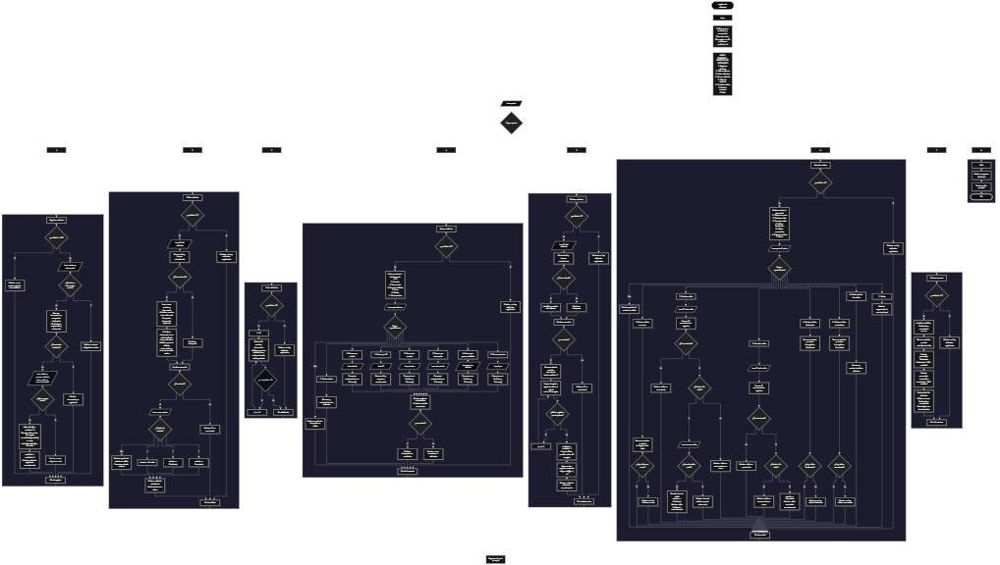

Este proyecto, llamado <b>registro de visitantes</b>, fue desarrollado en <b>visual basic .net</b> como un ejercicio práctico para fortalecer la lógica de programación mediante la creación de un sistema de registro y control de visitantes desde la consola. El programa cuenta con un menú principal de ocho opciones que permite <b>registrar, editar, eliminar, buscar, listar y controlar las visitas</b>, además de consultar un resumen general de los registros. Cada visitante almacena información como el nombre, documento, teléfono, persona visitada, área, motivo, hora de entrada, hora de salida y estado de la visita, utilizando arreglos con una capacidad máxima de <b>20 visitantes durante la ejecución</b>. Durante su desarrollo se aplicaron conceptos fundamentales de programación, como variables, arreglos, estructuras condicionales, ciclos repetitivos y estructuras de selección, además de procesos para buscar, modificar, eliminar y reorganizar registros. Este proyecto permite poner en práctica los conocimientos adquiridos en Visual Basic .NET y comprender cómo administrar información mediante un sistema de control de visitas.

<h2 align="center">⚙️ Funcionamiento del menú principal</h2>

### ➕ Registrar visitante

La opción <b>1) registrar visitante</b> permite agregar un nuevo visitante al sistema. Antes de realizar el registro, el programa comprueba que la cantidad de visitantes almacenados sea menor a <b>20</b>, utilizando la condición <b>cantidad &gt;= 20</b> para impedir nuevos registros cuando se alcanza la capacidad máxima. Si existe espacio disponible, solicita el <b>nombre, documento, teléfono, persona visitada, área, motivo de la visita y hora de entrada</b>. Cada campo obligatorio debe contener información. Además, comprueba que el documento no se encuentre registrado anteriormente mediante una comparación que no distingue entre mayúsculas y minúsculas. Si todos los datos son válidos, asigna un identificador consecutivo utilizando <b>cantidad + 1</b>, almacena la información en sus respectivos arreglos, establece la hora de salida como una cadena vacía y asigna el estado inicial <b>"En visita"</b>. Finalmente, aumenta la variable <b>cantidad</b> en uno y muestra los datos del visitante registrado junto con el mensaje <b>"visitante registrado correctamente."</b>.

### ✏️ Editar visitante

La opción <b>2) editar visitante</b> permite modificar la información de un visitante mediante su identificador. Primero, el programa comprueba si existen visitantes registrados utilizando la variable <b>cantidad</b>. Si no hay registros, muestra el mensaje <b>"no hay visitantes registrados."</b>. En caso contrario, solicita el ID del visitante y utiliza un ciclo <b>For</b> para localizarlo dentro del arreglo <b>ids</b>. Cuando encuentra una coincidencia, permite actualizar el <b>nombre, documento, teléfono, persona visitada, área, motivo, hora de entrada y hora de salida</b>. Los campos que se dejan vacíos conservan sus valores anteriores. Si se introduce un documento nuevo, el programa comprueba que no esté registrado por otro visitante, excluyendo el registro que se está editando. Después, presenta un submenú para seleccionar el estado de la visita: <b>"En visita", "Finalizada" o "Cancelada"</b>. Si la opción de estado no es válida, muestra un mensaje de advertencia y conserva el estado anterior. Finalmente, muestra el mensaje <b>"visitante actualizado correctamente."</b> y presenta la información del visitante modificado.

### 📋 Listar visitantes

La opción <b>3) listar visitantes</b> permite visualizar todos los visitantes registrados actualmente en el sistema. Antes de mostrar la información, el programa comprueba si la variable <b>cantidad</b> es igual a cero. Si no existen registros, presenta el mensaje <b>"no hay visitantes registrados."</b>. Si hay visitantes disponibles, utiliza un ciclo <b>For</b> para recorrer los diez arreglos desde la primera posición hasta el número total de visitantes registrados. Durante el recorrido, muestra el <b>ID, nombre, documento, teléfono, persona visitada, área, motivo, hora de entrada, hora de salida y estado</b> de cada visitante. Esta función facilita consultar todos los registros almacenados sin necesidad de realizar búsquedas individuales.

### 🔎 Buscar visitante

La opción <b>4) buscar visitante</b> permite localizar visitantes utilizando diferentes criterios de búsqueda. Primero, el programa comprueba si existen registros almacenados. Si no hay visitantes, muestra el mensaje <b>"no hay visitantes registrados."</b>. En caso contrario, presenta un submenú con siete alternativas: <b>buscar por ID, buscar por nombre, buscar por documento, buscar por persona visitada, buscar por área, buscar por estado y mostrar todos</b>. Para realizar las búsquedas, utiliza ciclos <b>For</b> que recorren los arreglos y comparan los datos introducidos con la información almacenada. La búsqueda por ID utiliza coincidencias exactas; la búsqueda por nombre, persona visitada y área permite coincidencias parciales mediante <b>Contains</b>; mientras que las búsquedas por documento y estado utilizan coincidencias exactas. Las comparaciones de texto no distinguen entre mayúsculas y minúsculas mediante <b>ToLower()</b>. Además, utiliza la variable lógica <b>encontrado</b> para determinar si existen coincidencias y mostrar los registros correspondientes. Si no encuentra resultados, presenta un mensaje indicando que no se encontraron visitantes.

### 🗑️ Eliminar visitante

La opción <b>5) eliminar visitante</b> permite eliminar un registro mediante el ID del visitante. Antes de comenzar, el programa comprueba que existan visitantes almacenados. Si no hay registros, muestra el mensaje <b>"no hay visitantes registrados."</b>. Si existen visitantes, solicita el identificador que se desea eliminar y utiliza un ciclo <b>For</b> para localizarlo en el arreglo <b>ids</b>. Cuando encuentra una coincidencia, inicia el proceso de reorganización de los diez arreglos mediante otro ciclo <b>For</b>, controlado por la variable <b>j</b>, que desplaza una posición hacia la izquierda los datos de los visitantes posteriores. Después, disminuye la variable <b>cantidad</b> en uno, limpia la última posición ocupada y vuelve a asignar identificadores consecutivos a los registros restantes. Finalmente, muestra el mensaje <b>"visitante eliminado correctamente."</b>. Si el ID introducido no corresponde a ningún visitante registrado, informa que no se encontró un visitante con ese identificador.

### 🔄 Controlar visitas

La opción <b>6) controlar visitas</b> permite administrar el estado de las visitas registradas mediante un submenú de siete alternativas. Antes de mostrar las opciones, el programa comprueba que existan visitantes almacenados. Si no hay registros, presenta el mensaje <b>"no hay visitantes registrados."</b>. En caso contrario, permite <b>mostrar las visitas en curso, finalizar una visita, cancelar una visita, mostrar las visitas finalizadas, mostrar las visitas canceladas y mostrar todas las visitas</b>. Para mostrar las visitas según su estado, utiliza ciclos <b>For</b> y compara el contenido del arreglo <b>estados</b> con los valores correspondientes. Al finalizar una visita, solicita la hora de salida y comprueba que no esté vacía; si es válida, almacena la hora y cambia el estado a <b>"Finalizada"</b>. Para cancelar una visita, localiza el registro mediante su ID y cambia su estado a <b>"Cancelada"</b>. Ambas operaciones solamente se permiten cuando la visita se encuentra en estado <b>"En visita"</b>. La opción siete permite regresar al menú principal.

### 📊 Mostrar resumen

La opción <b>7) mostrar resumen</b> permite consultar estadísticas generales sobre los visitantes registrados. Primero, el programa comprueba si existen registros almacenados. Si no hay visitantes, muestra el mensaje <b>"no hay visitantes registrados."</b>. En caso contrario, inicializa tres contadores: <b>enVisita, finalizadas y canceladas</b>, que permiten clasificar los registros según el estado de cada visita. Después, utiliza un ciclo <b>For</b> para recorrer el arreglo <b>estados</b> y aumentar el contador correspondiente mediante estructuras condicionales. Una vez finalizado el recorrido, calcula los porcentajes de visitas finalizadas y canceladas utilizando la cantidad total de visitantes como referencia. Finalmente, muestra el total de visitantes, las visitas en curso, las visitas finalizadas, las visitas canceladas y sus respectivos porcentajes, utilizando dos decimales para presentar los resultados.

### 🚪 Salir del menú principal

La opción <b>8) salir</b> permite finalizar la ejecución del programa y muestra el mensaje <b>"programa finalizado."</b>. El menú principal se encuentra dentro de una estructura repetitiva <b>Do...Loop While</b>, que mantiene el sistema en funcionamiento mientras la variable <b>opcion</b> sea diferente de <b>8</b>. Cuando el usuario selecciona esta alternativa, el ciclo termina y el programa finaliza su ejecución.

<h2 align="center">🧠 Temas aplicados en el proyecto</h2>

### 📦 Variables

En este proyecto se utilizan variables para controlar la cantidad de visitantes registrados, almacenar las opciones seleccionadas en los menús, identificar los registros que se desean modificar o eliminar, controlar los recorridos de los arreglos y comprobar si se encontraron coincidencias durante las búsquedas. También se emplean variables para almacenar temporalmente los datos introducidos por el usuario y calcular las estadísticas de las visitas.

🔢 **Opcion:** Almacena la opción seleccionada por el usuario en el menú principal.

📊 **Cantidad:** Controla el número actual de visitantes registrados.

🔄 **I:** Funciona como contador en los ciclos y permite recorrer los arreglos para localizar o mostrar visitantes.

🔁 **J:** Controla los recorridos utilizados para desplazar los datos durante la eliminación de un visitante y reorganizar los identificadores.

🔎 **IdBuscar / IdEditar / IdEliminar:** Almacenan el identificador utilizado para localizar, modificar o eliminar un visitante, según la operación.

✅ **Encontrado:** Variable lógica que indica si se encontró un visitante durante una búsqueda o una operación de edición o eliminación.

📋 **OpcionBuscar / OpcionControl:** Almacenan las alternativas seleccionadas en los submenús de búsqueda y control de visitas.

📈 **EnVisita / Finalizadas / Canceladas:** Contabilizan las visitas según su estado para elaborar el resumen general.

### 🗃️ Arreglos

En este proyecto se utilizan diez arreglos relacionados entre sí para almacenar la información de cada visitante. Cada arreglo tiene una capacidad de <b>20 posiciones</b> y utiliza el mismo índice para representar los datos correspondientes a una misma persona. Por ejemplo, la información de un visitante almacenado en la posición <b>0</b> se encuentra distribuida entre <b>ids[0], nombres[0], documentos[0], telefonos[0], personasVisitadas[0], areas[0], motivos[0], horasEntrada[0], horasSalida[0] y estados[0]</b>. Esta organización permite registrar, consultar, modificar, buscar y eliminar visitantes manteniendo relacionados todos sus datos.

🆔 **Ids[20]:** Almacena los identificadores de los visitantes registrados.

📝 **Nombres[20]:** Almacena los nombres de los visitantes.

🪪 **Documentos[20]:** Almacena los documentos de identidad de los visitantes.

📞 **Telefonos[20]:** Almacena los números de teléfono de los visitantes.

👤 **PersonasVisitadas[20]:** Almacena los nombres de las personas a quienes visitan.

🏢 **Areas[20]:** Almacena las áreas que desean visitar.

📋 **Motivos[20]:** Almacena los motivos de cada visita.

🕒 **HorasEntrada[20]:** Almacena las horas de entrada de los visitantes.

🕓 **HorasSalida[20]:** Almacena las horas de salida de los visitantes.

📌 **Estados[20]:** Almacena el estado actual de cada visita: en visita, finalizada o cancelada.

### 🔀 Estructuras condicionales

En este proyecto se utilizan las estructuras <b>If, ElseIf y Else</b> para controlar las diferentes operaciones del sistema. Estas condiciones permiten comprobar si existe espacio disponible para registrar visitantes, verificar que los campos obligatorios no estén vacíos, detectar documentos duplicados, determinar si un visitante existe, comprobar el estado de una visita y decidir si puede finalizarse o cancelarse. También se utilizan para clasificar los registros y calcular las estadísticas del resumen general.

### 🔄 Estructuras repetitivas

En este proyecto se utilizan las estructuras repetitivas <b>For</b> y <b>Do...Loop While</b>. Los ciclos <b>For</b> permiten recorrer los arreglos para buscar visitantes, mostrar sus datos, comprobar documentos duplicados, contar las visitas según su estado y localizar registros para editarlos o eliminarlos. También se utilizan para desplazar los datos durante la eliminación y reorganizar los identificadores. Por otro lado, el ciclo <b>Do...Loop While</b> mantiene activo el menú principal y permite ejecutar las diferentes operaciones hasta que el usuario selecciona la opción de salida.

### 🎯 Estructura según

El programa utiliza la estructura <b>Select Case</b> para evaluar la opción almacenada en la variable <b>opcion</b> y ejecutar las instrucciones correspondientes a cada alternativa del menú principal. También utiliza esta estructura en los submenús de búsqueda, control de visitas y selección del estado de un visitante. Cada caso representa una operación específica, mientras que el bloque <b>Case Else</b> permite mostrar mensajes de advertencia cuando se introduce una opción que no está definida.

### 🔢 Dimensionamiento de arreglos

El programa utiliza la declaración de arreglos con el límite <b>(19)</b> para establecer 20 posiciones disponibles, desde el índice <b>0</b> hasta el índice <b>19</b>. Esta capacidad se aplica a los diez arreglos que almacenan la información de los visitantes. La variable <b>cantidad</b> controla cuántas posiciones están ocupadas y permite limitar los recorridos a los registros existentes. Además, se utiliza una condición para impedir nuevos registros cuando se alcanza la capacidad máxima de <b>20 visitantes</b>.

### 🔄 Reorganización de registros

Cuando se elimina un visitante, el programa utiliza un ciclo <b>For</b> controlado por la variable <b>j</b> para desplazar los datos de los registros posteriores una posición hacia la izquierda en los diez arreglos. Después, disminuye la variable <b>cantidad</b> en uno y limpia la última posición que anteriormente estaba ocupada. Finalmente, utiliza otro ciclo <b>For</b> para asignar nuevamente identificadores consecutivos mediante la expresión <b>j + 1</b>. Este procedimiento permite mantener los registros organizados y evitar espacios vacíos entre los visitantes almacenados.

### 📐 Cálculos y porcentajes

El programa aplica operaciones aritméticas para obtener estadísticas sobre el control de visitas. Para calcular el porcentaje de visitas finalizadas, multiplica la cantidad de visitas finalizadas por <b>100</b> y divide el resultado entre la cantidad total de visitantes. De manera similar, calcula el porcentaje de visitas canceladas. Los resultados se muestran utilizando el formato <b>ToString("0.00")</b>, que permite presentar los porcentajes con dos cifras decimales.

<h2 align="center">¿Cómo se implementaron las operaciones crud en el proyecto?</h2>

Las operaciones <b>crud</b> se implementaron mediante las opciones del menú principal, permitiendo administrar la información de los visitantes registrados. La operación <b>crear</b> corresponde a <b>registrar visitante</b>, donde se almacenan los datos de una nueva persona; <b>leer</b> se realiza mediante las opciones <b>buscar visitante y listar visitantes</b>, que permiten consultar los registros almacenados; <b>actualizar</b> corresponde a <b>editar visitante</b>, donde se modifican los datos de una persona registrada; y <b>eliminar</b> se realiza mediante la opción <b>eliminar visitante</b>, que también reorganiza los arreglos para conservar el orden de los registros. Adicionalmente, el sistema incorpora la opción <b>controlar visitas</b>, que permite administrar el estado de cada visita, y la opción <b>mostrar resumen</b>, que presenta estadísticas generales. Todas estas operaciones utilizan variables, arreglos, estructuras condicionales y ciclos para gestionar la información temporalmente durante la ejecución del programa.

<h2 align="center">Diagrama de flujo del proyecto</h2>

<h2 align="center">🛡️ Validaciones del programa</h2>

### 📭 No existen visitantes registrados

Esta validación se utiliza en las opciones de <b>editar, listar, buscar, eliminar, controlar visitas y mostrar resumen</b>. El programa comprueba si la variable <b>cantidad</b> es igual a <b>0</b> y, si no existen visitantes registrados, muestra el mensaje <b>"no hay visitantes registrados."</b>. Esta comprobación evita realizar operaciones que necesitan información almacenada cuando el sistema se encuentra vacío.

### ⚠️ Capacidad máxima alcanzada

Esta validación se utiliza durante el registro de nuevos visitantes para controlar la capacidad máxima de los arreglos. El programa comprueba si <b>cantidad &gt;= 20</b> antes de permitir agregar un nuevo registro. Si se alcanza el límite establecido, muestra el mensaje <b>"no se pueden registrar mas visitantes."</b> e impide almacenar nuevos datos hasta que se elimine algún visitante.

### 📝 Campos obligatorios vacíos

Durante el registro, el programa comprueba que el nombre, documento, teléfono, persona visitada, área, motivo y hora de entrada no estén vacíos. Si alguno de estos campos contiene una cadena vacía, muestra un mensaje indicando que el dato correspondiente es obligatorio e impide continuar con el registro. Durante la edición, los campos vacíos no reemplazan la información existente, por lo que se conservan los valores anteriores.

### 🪪 Documento duplicado

Esta validación se utiliza al registrar y editar visitantes para evitar que dos personas tengan el mismo documento. El programa recorre el arreglo <b>documentos</b> y compara los valores mediante <b>ToLower()</b>, permitiendo detectar coincidencias sin distinguir entre mayúsculas y minúsculas. Durante la edición, excluye de la comparación la posición del visitante actual para permitir conservar su propio documento. Si el documento ya pertenece a otro visitante, muestra un mensaje de advertencia e impide reemplazarlo.

### ❌ Visitante no encontrado

Esta validación se utiliza durante las operaciones de edición, eliminación y búsqueda. El programa inicializa la variable lógica <b>encontrado</b> con el valor <b>False</b> y recorre el arreglo <b>ids</b> o los arreglos correspondientes al criterio de búsqueda. Cuando encuentra una coincidencia, cambia la variable a <b>True</b> y ejecuta la operación correspondiente. Si finaliza el recorrido sin encontrar el registro solicitado, muestra un mensaje indicando que no se encontró el visitante.

### 🔄 Estado de visita no válido

Durante la edición de visitantes, el programa presenta tres estados disponibles: <b>"En visita", "Finalizada" y "Cancelada"</b>. Si el usuario introduce una opción diferente de las establecidas, muestra el mensaje <b>"opcion de estado no valida."</b> y conserva el estado anterior del visitante. Aunque los demás datos introducidos pueden haberse actualizado, el estado no cambia cuando la selección no corresponde a una alternativa válida.

### 🕓 Hora de salida vacía

Esta validación se utiliza cuando se selecciona la opción de finalizar una visita. Primero, el programa comprueba que el visitante exista y que su estado sea <b>"En visita"</b>. Después, solicita la hora de salida y verifica que no sea una cadena vacía. Si no se introduce una hora, muestra el mensaje <b>"la hora de salida no puede estar vacia."</b> y mantiene la visita en curso. Si se introduce un valor, almacena la hora de salida y actualiza el estado a <b>"Finalizada"</b>.

### 🚫 Visita que no está en curso

Esta validación se utiliza al intentar finalizar o cancelar una visita. El programa comprueba que el estado del visitante sea exactamente <b>"En visita"</b> antes de permitir cualquiera de las dos operaciones. Si la visita ya está finalizada o cancelada, muestra el mensaje <b>"la visita no se encuentra en curso."</b> e impide cambiar nuevamente su estado mediante estas opciones.

### ⚠️ Opción inválida

Los menús principales y secundarios utilizan la estructura <b>Select Case</b> junto con el bloque <b>Case Else</b> para detectar opciones que no corresponden a las alternativas disponibles. Cuando el usuario introduce un número no definido, el programa muestra un mensaje indicando que la opción seleccionada no es válida y permite continuar con la ejecución del sistema.

<h2 align="center">🎯 Objetivo del proyecto</h2>

El objetivo principal de este proyecto es fortalecer la <b>lógica de programación</b> mediante el desarrollo de un sistema de registro y control de visitantes en <b>visual basic .net</b>. A través de su construcción se busca aplicar los conocimientos adquiridos sobre variables, arreglos, estructuras condicionales, ciclos repetitivos y estructuras de selección, integrándolos para resolver un problema de manera organizada. Además, el proyecto permite comprender cómo registrar, consultar, modificar y eliminar información, controlar el estado de las visitas y generar estadísticas mediante una aplicación de consola, estableciendo una base para desarrollar sistemas de gestión más completos con otros lenguajes y tecnologías.

